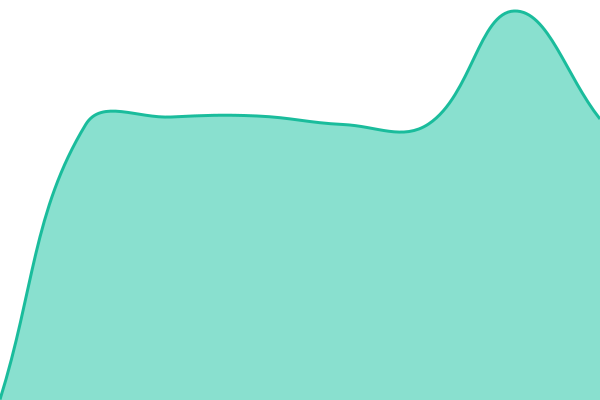

# [📈 Live Status](https://status.schrat.eco): <!--live status--> **Alle Systeme laufen**

This repository contains the open-source uptime monitor and status page for [Gerrit Balindt](https://gruenecho.de/en), powered by [Upptime](https://github.com/upptime/upptime).

With [Upptime](https://upptime.js.org), you can get your own unlimited and free uptime monitor and status page, powered entirely by a GitHub repository. We use [Issues](https://github.com/b-lack/schrat-status/issues) as incident reports, [Actions](https://github.com/b-lack/schrat-status/actions) as uptime monitors, and [Pages](https://status.schrat.eco) for the status page.

<!--start: status pages-->
<!-- This summary is generated by Upptime (https://github.com/upptime/upptime) -->
<!-- Do not edit this manually, your changes will be overwritten -->
<!-- prettier-ignore -->
| URL | Status | History | Response Time | Uptime |
| --- | ------ | ------- | ------------- | ------ |
|  [Website](https://schrat.eco) | Erreichbar | [website.yml](https://github.com/b-lack/schrat-status/commits/HEAD/history/website.yml) | 

 964ms
     
 | 

<a href="https://status.schrat.eco/history/website">100.00%</a>
    

|  [Web-App](https://app.schrat.eco) | Erreichbar | [web-app.yml](https://github.com/b-lack/schrat-status/commits/HEAD/history/web-app.yml) | 

 495ms
     
 | 

<a href="https://status.schrat.eco/history/web-app">100.00%</a>
    

|  [Anmeldung](https://db.schrat.eco/auth/v1/health) | Erreichbar | [anmeldung.yml](https://github.com/b-lack/schrat-status/commits/HEAD/history/anmeldung.yml) | 

 691ms
     
 | 

<a href="https://status.schrat.eco/history/anmeldung">100.00%</a>
    

|  [Datenbank-API](https://db.schrat.eco/rest/v1/schema_tags?select=id&limit=1) | Erreichbar | [datenbank-api.yml](https://github.com/b-lack/schrat-status/commits/HEAD/history/datenbank-api.yml) | 

 419ms
     
 | 

<a href="https://status.schrat.eco/history/datenbank-api">100.00%</a>
    

|  [Synchronisation](https://sync.schrat.eco/probes/readiness) | Erreichbar | [synchronisation.yml](https://github.com/b-lack/schrat-status/commits/HEAD/history/synchronisation.yml) | 

 695ms
     
 | 

<a href="https://status.schrat.eco/history/synchronisation">100.00%</a>
    

|  [Kundensupport](https://support.schrat.eco) | Erreichbar | [kundensupport.yml](https://github.com/b-lack/schrat-status/commits/HEAD/history/kundensupport.yml) | 

 662ms
     
 | 

<a href="https://status.schrat.eco/history/kundensupport">100.00%</a>
    

|  [E-Mail-Richtlinie](https://mta-sts.schrat.eco/.well-known/mta-sts.txt) | Erreichbar | [e-mail-richtlinie.yml](https://github.com/b-lack/schrat-status/commits/HEAD/history/e-mail-richtlinie.yml) | 

 594ms
     
 | 

<a href="https://status.schrat.eco/history/e-mail-richtlinie">100.00%</a>
    

<!--end: status pages-->

[**Visit our status website →**](https://status.schrat.eco)

## 📄 License

- Powered by: [Upptime](https://github.com/upptime/upptime)
- Code: [MIT](./LICENSE) © [Anand Chowdhary](https://anandchowdhary.com)
- Data in the `./history` directory: [Open Database License](https://opendatacommons.org/licenses/odbl/1-0/)
